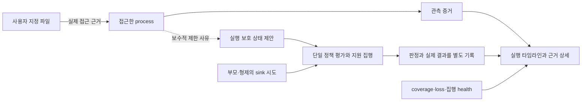

# P04 — 위협·검증·증거 화면 계약 제안

2026-10-25. 상태: **설계 초안 작성 완료 / G1 미채택 / 새 runtime·화면 미구현**.
입력: [제품 범위](PRODUCT_SCOPE_PROPOSAL.md), [재사용 비교](REUSE_COMPARISON_PLAN.md).
이 문서는 현재 event JSON schema나 policy YAML을 변경하지 않는다. 아래 필드명은
설계용 개념이며 현재 API에 존재한다고 가정하지 않는다.

## 1. 보호 경계와 책임

첫 profile 후보는 개발자 한 명의 지정 파일 분석 실행이다. 관리자는 신뢰하고
대상 agent/worker가 읽는 문서·도구 응답은 신뢰하지 않는다. kernel exploit과
host root compromise는 보호 범위 밖이다. 사용자 지정 source가 없는 데이터도
안전하다고 판정하지 않는다.

| 책임 | 소유자 / 요구 조건 |
|---|---|
| source 분류·허용 목적지·사용자 출력 승인 | 사용자 정책. AI가 자기 source label을 임의로 해제하지 못함 |
| 실제 접근 근거 | sensor와 해당 OS event. successful open, attempt, byte read를 구분 |
| 규범적인 label·policy 의미 | 현재 taint/policy 소유 경계. 외부 엔진 채택은 G2에서 권위·변환 계약 별도 결정 |
| 제한된 동기 집행 | 승인된 projection/선정 엔진. audit 소비 순서에 의존해 사전 차단을 주장하지 않음 |
| 실행 귀속·외부 IPC/공유 자원/권한 이탈 제한 | 선정된 격리 제공자. AgentTaint 자체가 완전한 sandbox를 제공한다고 가정하지 않음 |
| 사용자 증거·보존·조회 | 비특권 저장/읽기 UI 경계. UI 실패가 policy를 완화하거나 label을 지우지 않음 |

PID만으로 상태를 결합하지 않는다. 기존 ProcessKey/run identity/POSIX session_id를
유지하며 대화 session과 구별한다. 외부 process가 전달한 임의 run ID를 신뢰하지
않고 실제 scope membership과 연결한다.

## 2. 근거·상태·결정을 분리한다

[렌더링된 설계 흐름도](assets/proposed-evidence-flow.svg) — 구현 결과가 아닌 제안이다.



점선은 실제 byte 이동을 뜻하지 않는다. 같은 run 제한 사유를 나타낸다.
Audit의 process label과 proposed run restriction을 다른 필드·문구로 표현한다.
실행 상태를 `안전`이라고 표시하지 않는다. `source 근거 없음`, `제한 적용`,
`상태 불명/장애`, `종료·정리 확인`을 구분한다.

source state update는 source 접근을 허용하는 경계보다 먼저 반영되어야 하며
그 뒤의 지원 송신은 새 상태를 확인해야 한다. open이 나중에 실패하면 보수적
제한이 남을 수 있지만 successful-open event를 만들지 않는다. 기존 연결·대기열·
다른 CPU의 송신과의 순서는 P06에서 실제 메커니즘을 선정하고 검증한다.
관찰 timestamp의 정렬만으로 이 순서를 증명하지 않는다.

## 3. 세분화한 테스트 수용 계약

모든 행은 미실행이다. P06의 E0~E7을 실제 fixture로 나눌 때 아래 조건을 사용한다.
기존 테스트를 재사용하려면 source/환경/보장 범위가 같은지 먼저 확인한다.

| ID | fixture와 동기화 / 대조군 | 관측할 근거와 통과 조건 |
|---|---|---|
| T01 시작 준비 | 필수 hook/격리/capacity 누락을 각각 주입. target 첫 동작 marker 사용 | unsupported block이면 target marker가 없어야 함. 다른 mode로 자동 fallback 금지 |
| T02 정상 source 전 | 합성 수신기와 연결·전송하고 ACK 확인 | 허용된 marker 실제 수신. 동일 fixture의 통제 가능성 확인 |
| T03 직접 source 후 | 지정 source open 완료 또는 승인된 projection 시점과 send 사이에 결정적 barrier | 해당 API 거부 결과, receiver의 금지 marker 비수신, source/decision 근거. 실패 open 사실은 별도 기록 |
| T04 child→parent/형제 | child source 처리 후 부모/형제 release, 같은 run/다른 run 대조 | 같은 run 제한·다른 run 격리. 부모가 읽었다는 가짜 접근 event 없음 |
| T05 기존 연결 | source 전에 연결 완료/ACK, source 뒤 같은 FD로 송신 | send 단계의 실제 제한 또는 명시 unsupported. connect 거부만으로 통과 불가 |
| T06 프로토콜 우회 | IPv6, UDP, 지원 환경의 proxy/direct 경로를 각각 독립 fixture로 분리 | 허용되지 않은 경로가 격리로 제거되거나 집행됨. hook 미지원이면 strict profile 시작 조건으로 거부 |
| T07 source 별칭/초기 상태 | relative/symlink/hardlink/rename, inherited FD/mapping/stdin을 각각 검사 | 지원하는 alias는 같은 source로 처리. 나머지는 입력 경계를 닫거나 profile 시작 거부. 성공 open 경로만 검사하고 전체 보호 주장 금지 |
| T08 경쟁 | source actor와 sender를 barrier로 제어하고 여러 순서/CPU를 실행 | 새 source에서 읽은 고유 synthetic marker가 gate 이후 외부로 나가지 않음. sleep/time ordering 추정 대신 상태·결과·receiver 근거 |
| T09 상태 실패 | map capacity/update/lookup 실패, identity reuse를 각각 주입 | 해당 profile의 실패 동작, clean으로 오인하지 않음, 다른 run에 오염 없음 |
| T10 감사 손실 | ring drop, 부분 write/ENOSPC, 저장 상한을 별도 주입 | incomplete와 loss reason 유지. audit loss만으로 집행 성공/실패를 추정하지 않음 |
| T11 supervisor 종료 | target 활동 중 supervisor 종료/강제 종료, 남은 descendant·link/scope 확인 | provider가 대상 실행을 안전하게 종료하거나 검증된 집행이 지속. 증거 없으면 이 장애의 보호를 지원하지 않음 |
| T12 외부 전달/재사용 | 외부 same-UID process, UNIX socket/FD, 공유 파일, 다음 run cache 시도 | 승인되지 않은 경계 폐쇄 또는 profile 거부. 실행 종료·로그 삭제가 산출물 안전 판정이 되지 않음 |
| T13 lifecycle | 정상 종료·취소·실패 후 scope/process/FD/listener/임시 자원 확인 | test-owned 자원 정리, 사용자 파일 무단 삭제 없음, 다음 run identity 분리 |
| T14 실제 사용자 작업 | 같은 범위의 실제 로컬 모델로 합성 파일 분석, 사용자 출력 | 정상 작업 완료와 과도한 제한 기록. helper 테스트 성공을 대체하지 않음 |
| T15 화면 일치 | allow/deny/unknown/incomplete/unsupported fixture를 저장→조회→표시 | 원시 evidence와 동일 의미, 아래 화면 수용 조건 충족 |

전역 판정은 `pass/fail/unsupported/not_tested/inconclusive`다. 정상 no-loss
fixture에서 loss/incomplete는 PASS가 아니다. 의도적으로 loss를 주입하는 T10은
incomplete가 정확히 보고되는 것을 검증하는 **장애 동작 PASS**일 수 있지만,
그 실행을 무손실이라고 기록하지 않는다.

새 profile이 필요로 하는 경로의 unsupported를 성공 취급하지 않는다. 지원 범위를
줄이려면 제품 정의·UI·capability 검사도 같이 변경하는 별도 결정을 거친다.

## 4. 저장·조회 입력 계약

저장 엔진/DB는 여기서 선정하지 않는다. P08a에서 다음 논리 기록과 version,
마이그레이션·권한·용량·기간·삭제·부분 기록을 결정한다.

| 기록 | 필요한 개념 필드 | 주의점 |
|---|---|---|
| Run | run identity, 시작/종료, 요청/활성 mode, policy version, source/build/kernel/arch, lifecycle/health | POSIX session과 사용자 대화 session 혼용 금지 |
| Source evidence | event identity, process identity, resource 별칭, 분류 근거 참조, observation stage/result | 성공 open/attempt/result delivery/byte read 구분. 첫 범위는 파일 |
| Restriction | run/process 적용 범위, source 근거 참조, state version, 보수적 적용 이유 | proposed run-wide 상태를 실제 data-flow edge로 그리지 않음 |
| Decision/effect | decision identity, event 참조, rule/version, verdict, requested action, actual result, timing/capability | verdict deny만으로 block confirmed 표시 금지 |
| Coverage/health | audit loss reason/count, 저장 실패/구간, supported surfaces, 집행 상태와 원인 | 누락 기록 자체가 저장되지 않을 수 있어 producer summary/상태 조회와 결합하는 계약 필요 |

진단 상세 경로는 별도 opt-in이며 기본은 자원 별칭이다. payload, prompt/response,
전체 argv, 환경변수, DB 결과를 기본 수집하지 않는다. 대상 프로그램의 사용자
stdout과 감사 저장 스트림을 구분한다.

수집 순번은 수집 순서일 뿐 모든 CPU의 실제 인과 순서가 아니다. 화면은 원래
timestamp/clock 정보와 수집 순번을 구분하며, 인과 참조나 검증된 state version이
없으면 단순 시간 근접으로 source→sink 관계를 확정하지 않는다.

조회는 run/time/type/resource/rule/coverage 기준 필터와 제한된 페이지 크기를
갖는다. 삭제해도 실행 중 집행 상태는 해제되지 않는다. 삭제 권한·보존 기간은
P08a에서 결정하며 감사 삭제와 산출물 재사용 허용을 연결하지 않는다.

## 5. 화면 구성과 표시 예

### 실행 목록

| 표시 | 내용 |
|---|---|
| 작업 / run | 사용자 표시명과 충돌 없는 run ID, 시작/종료 |
| 모드 | 요청 block / 실제 none 등 둘 다 표시 |
| 제한 | source 근거 없음 / 실행 제한 적용 / 상태 불명 |
| 관측 | complete / incomplete / unknown과 원인 |
| 집행 | active / failed / unknown, 지원 surface 범위 |
| 사건 수 | 관측된 수치임을 표시. 0건을 안전 점수로 바꾸지 않음 |

### 실행 상세 타임라인

아래는 **가상 화면 예시**이며 실제 실행 결과가 아니다.

```text
Run demo-01     요청: block     활성: block
관측: incomplete (ring drop 2)     집행 상태: unknown
보호 대상: customer-sample (사용자 지정)

수집 #12  child A   파일 open 성공          [근거 E12]
수집 #13  run       실행 제한 적용 제안     [E12 참조 / 보수적 범위]
수집 #14  parent B  시험 목적지 송신 시도   [근거 E14]
수집 #15  policy    deny 판정               [rule R1]
                   실제 집행 결과: 미확인

[판정 근거 보기] [수집 공백 보기] [지원 범위 보기]
```

같은 사례에서 집행 결과가 없으면 “차단 완료”를 표시하지 않는다. 실제 pre-op
거부와 대응 결과가 확인된 사례에만 그 표현을 쓴다. post-event kill은 “사후 종료”로
표시하고 이미 발생한 effect가 취소됐다고 설명하지 않는다.

### 근거 상세

한 화면에서 ① 지정된 source와 분류 근거 ② 실제 접근 process/결과 ③ 제한 적용
범위와 사유 ④ 정책 version/rule ⑤ 요청 effect와 실제 집행 결과 ⑥ 지원 capability와
수집 공백을 확인한다. test receiver의 비수신 증거는 acceptance artifact에 속하며
운영 UI가 모든 원격 수신 상태를 알고 있는 것처럼 표시하지 않는다.

### 화면 수용 기준

- 색상만으로 상태를 구별하지 않고 문구·아이콘·근거 링크를 함께 제공한다.
- source 근거 없음/0건/관측 중단을 “안전”으로 합치지 않는다.
- incomplete를 숨기는 필터를 기본값으로 두지 않는다. 빈 결과와 수집 실패를 구분한다.
- raw event와 decision/effect의 연결이 끊기면 “근거 누락”을 표시한다.
- source 지정과 source 실제 접근, 연결 관찰과 DB 결과 수신을 서로 바꾸어 표시하지 않는다.
- 첫 화면은 읽기 전용이다. 정책 수정·예외 승인·label 해제 버튼은 추가하지 않는다.
- localhost bind만으로 인증이 된다고 가정하지 않는다. session 인증, origin/host 검사,
  CSRF 경계(상태 변경이 생기는 경우), 파일 권한, 비밀 query string 금지를 P08에서 검증한다.
- 외부 CDN·telemetry가 없는 bundle을 기본 후보로 하고 실제 브라우저 network를 검사한다.
  Graphify export HTML을 제품 UI로 복사하지 않는다.

## 6. G1 이후의 정확한 변경 범위

G1은 [P02의 A/B/C 변경안](PRODUCT_SCOPE_PROPOSAL.md)을 선택하는 단계다.
선택 후 P05는 규범 문서·Phase prompt·허용 경로에 대한 concrete diff를 만들고,
P06 실험은 승인된 guest·후보·fixture 범위에서만 시작한다. G2 전에 엔진 교체를
확정하지 않으며 P08 UI 코드를 저장/조회 계약보다 먼저 작성하지 않는다.

이번 산출물은 위협·테스트·정보 설계 문서다. 새로운 감지·차단·저장·화면 기능은
구현하지 않았다. byte-level taint tracking을 주장하지 않는다.
post-event detection을 prevention으로 부르지 않는다.
