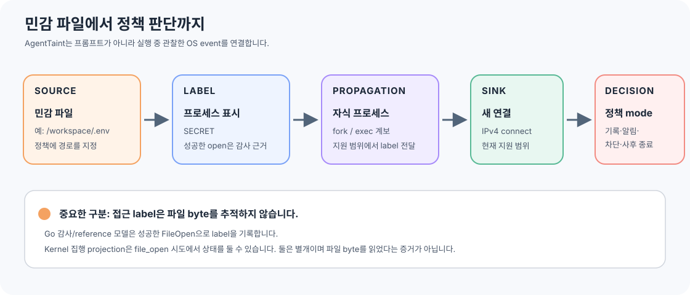
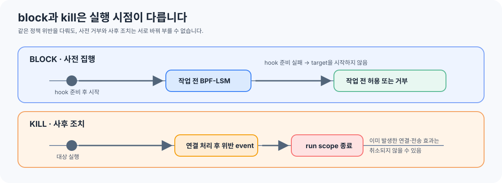

# AgentTaint 프로젝트 한눈에 보기

이 문서는 AgentTaint를 처음 보는 개발자가 프로젝트의 목적과 경계를 빠르게 이해하도록 쓴 개요입니다. 설치·운영 절차나 전체 검증을 대신하지 않습니다.

> 이 문서는 처음 읽는 사람을 위한 요약입니다. 정확한 보안 계약과 검증 범위는 [보안 모델](SECURITY_MODEL.md), [아키텍처](ARCHITECTURE.md), [위협 모델](THREAT_MODEL.md), [구현 계획](IMPLEMENTATION_MASTER_PLAN.md)을 기준으로 확인하세요.

## 먼저 예를 들어 보겠습니다

정책에 `/workspace/.env`를 민감 파일로 지정했다고 가정합니다.

1. 사용자가 AgentTaint의 정책 mode를 지정해 에이전트를 실행합니다.
2. 에이전트 프로세스가 `/workspace/.env`를 엽니다. Go 감사/reference 모델은 성공한 open event를 확인해 그 프로세스에 `SECRET` label을 기록합니다.
3. 에이전트가 자식 `python` 프로세스를 만들면 지원되는 계보 전파로 label이 이어집니다.
4. 자식 프로세스가 정책에 지정된 IPv4 주소로 새 연결을 시도합니다.
5. 실행 mode가 `block`이고 필요한 BPF-LSM hook을 준비할 수 있으면 연결 전에 거부할 수 있습니다. `kill` mode라면 위반 event를 본 뒤 프로세스 실행 범위를 종료하므로 연결 효과가 먼저 발생했을 수 있습니다.

AgentTaint는 프롬프트의 의도나 에이전트 이름을 판별하지 않습니다. Linux에서 실제 발생한 파일·프로세스·네트워크 event를 관찰해 정책을 평가합니다. **민감 파일 접근 프로세스에 `SECRET` 표시를 붙이고, 그 표시가 자식 프로세스로 이어지는지 추적한 뒤, 지정된 네트워크 연결을 정책에 따라 기록하거나 제한합니다.**

## 동작 흐름



1. **Source — 보호할 파일:** 사용자가 정책에 경로를 지정합니다.
2. **Label — 프로세스 표시:** Go의 감사/reference 모델은 해당 파일을 성공적으로 연 사실을 확인하면 프로세스에 `SECRET` label을 부여합니다. 파일 내용을 읽었거나 특정 비밀 바이트가 사용됐다는 뜻은 아닙니다.
3. **Propagation — 자식 프로세스로 전달:** 지원되는 `fork`/`exec` 계보를 따라 프로세스 label을 전파합니다.
4. **Sink — 확인할 동작:** 현재 제한된 흐름은 프로세스가 새 IPv4 네트워크 연결을 시도하는 경우입니다.
5. **Decision — 정책 판단:** 명시한 주소 범위와 정책 mode에 따라 관찰, 알림, 사후 종료 또는 지원되는 사전 차단을 수행합니다.

집행용 kernel projection은 감사/reference 모델과 구분됩니다. 사전 집행에서는 `file_open` 시도만으로 kernel 상태가 보수적으로 설정될 수 있습니다. 따라서 파일 열기가 실패해도 이후 지원 sink가 차단될 수 있으며, 이것을 성공한 파일 열기나 파일 내용 읽기의 증거로 기록하지 않습니다. 자세한 계약은 [보안 모델](SECURITY_MODEL.md)에서 정의합니다.

## 실행 mode 차이

| Mode | 하는 일 | 동작 시점 |
|---|---|---|
| `monitor` | event와 정책 판단을 감사 파일에 기록합니다. | 관찰만 하며 차단하지 않음 |
| `notify` | 위반을 기록하고 알립니다. | 위반 event를 관찰한 뒤 |
| `block` | 지원되는 파일 열기와 새 IPv4 연결을 BPF-LSM hook에서 거부합니다. | 대상 작업이 수행되기 전 |
| `kill` | 명시된 `deny` 위반 뒤 해당 run scope를 종료합니다. | 위반 event가 발생한 뒤 |

`block`에 필요한 hook이나 권한을 준비하지 못하면, 자동으로 `kill`이나 `notify`로 바꾸지 않고 대상 프로그램을 시작하기 전에 실패합니다. `kill`은 이미 발생한 연결이나 전송 효과를 취소하지 않습니다.



## AgentTaint가 지키는 경계

- **프로세스 단위 label입니다.** 민감 파일에 접근했다는 프로세스 사실을 나타냅니다. 그 프로세스가 내보내는 모든 byte에 비밀이 들어 있다고 주장하지 않습니다.
- **실제 운영체제 동작을 봅니다.** 프롬프트 분류, LLM 판단, payload scan으로 보안 결정을 내리지 않습니다.
- **지원 범위가 제한돼 있습니다.** 현재 제품 방향은 Linux eBPF, 지정한 파일 경로, `fork`/`exec` 계보, 새 IPv4 연결입니다. 기존 socket의 전송, IPv6, UDP `sendto` 등 모든 유출 경로를 보장하지 않습니다.
- **파일 경로가 파일 객체의 고유 ID는 아닙니다.** 상대경로, symlink, hardlink, rename, mount 별칭을 같은 파일로 추론하지 않습니다.
- **관찰과 차단은 다릅니다.** event 기록이나 `notify`/`kill`은 사전 차단이 아닙니다. 차단은 해당 Linux 환경에서 필요한 hook의 준비와 실제 동작이 검증된 범위에만 해당합니다.
- **MVP 검증은 진행 중입니다.** README와 구현 계획에 기록된 대로 P4-04 전체 검증과 최종 보장 감사 V-01은 완료 전입니다. 지원 범위와 최신 증거는 [구현 계획](IMPLEMENTATION_MASTER_PLAN.md)을 확인하세요.

## 근거와 그림 읽기

흐름 그림은 저장소 문서에 적힌 개념을 단순화한 **개념도**입니다. 그림 자체는 kernel hook의 실제 attach, verifier 통과 또는 런타임 동작을 증명하지 않습니다. 아키텍처 책임은 [ARCHITECTURE.md](ARCHITECTURE.md), Source → Label → Propagation → Sink → Decision의 의미는 [SECURITY_MODEL.md](SECURITY_MODEL.md), 검증된 시나리오와 `not_tested` 항목은 [IMPLEMENTATION_MASTER_PLAN.md](IMPLEMENTATION_MASTER_PLAN.md)를 근거로 구분했습니다.

## 구성 요소

| 구성 요소 | 쉬운 설명 |
|---|---|
| `cmd/agenttaint` | 명령행 입구입니다. 환경을 진단하거나 사용자가 지정한 프로그램을 실행합니다. |
| `internal/sensor/linux` + `bpf/` | Linux에서 프로세스, 파일 열기, IPv4 연결 event를 수집합니다. |
| `internal/core` | 센서가 달라도 공통으로 쓰는 event와 자원 표현입니다. |
| `internal/taint` | Go reference 모델에서 label을 관리하고 프로세스 관계를 따라 전파합니다. |
| `internal/policy` | YAML 정책을 검증하고 event에 대한 일반적인 결정을 계산합니다. |
| `internal/enforce` | 검증된 정책 일부를 Linux kernel enforcement에 전달하고 준비 상태를 관리합니다. |
| `internal/runner` | 감시 범위와 프로세스 실행을 조율하고 event를 감사 파일로 기록합니다. |

Go 코드가 일반 정책 해석과 기준 taint 의미를 소유합니다. BPF 코드는 제한된 상태와 승인된 사전 집행만 맡으며 YAML이나 일반 정책 평가기를 구현하지 않습니다.

## 어디서 시작하나요?

개발 checkout에서 간단한 환경 진단은 다음과 같습니다.

```sh
go run ./cmd/agenttaint doctor --json
```

정책과 audit 파일을 지정해 policy mode로 실행하는 명령 형태는 다음과 같습니다.

```sh
./agenttaint run --mode block --policy ./policies/example.yaml --audit-file ./block-audit.jsonl --run-as 65534:65534 -- /path/to/agent
```

`/path/to/agent`와 정책 안의 source 경로는 예시 자리표시자입니다. 실제 Linux 실행 조건과 monitor mode 예시는 [README](../README.md)를 확인하세요. `doctor`는 정적 환경 정보를 보여줄 뿐 BPF hook의 실제 attach나 차단 가능성을 증명하지 않습니다.

## 더 읽을 자료

- [README](../README.md): 설치, 명령행 사용, 지원 mode와 문제 해결
- [SECURITY_MODEL.md](SECURITY_MODEL.md): Source → Label → Propagation → Sink → Decision의 규범적 정의
- [ARCHITECTURE.md](ARCHITECTURE.md): 패키지 책임과 구현 경계
- [THREAT_MODEL.md](THREAT_MODEL.md): 보호 대상, 위협 가정, 보장하지 않는 경로
- [ROADMAP.md](ROADMAP.md): Phase 순서와 제품 범위
- [IMPLEMENTATION_MASTER_PLAN.md](IMPLEMENTATION_MASTER_PLAN.md): 작업 상태와 검증 증거
